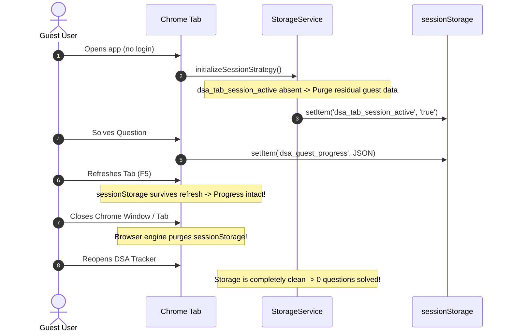
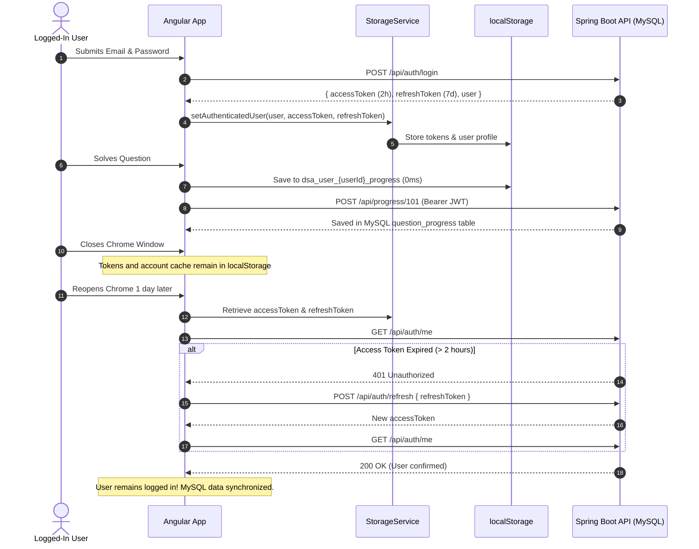

# 📊 Browser Data-Persistence Audit & Architecture Specification

**Project:** DSA Question Tracker  
**Stack:** Angular 18 (Signals & Standalone) + Spring Boot 3.3.2 (Java 17) + MySQL 8.x  
**Audit Date:** October 2026  
**Status:** Implemented & Verified (Firebase Completely Removed)  

---

## 1. Executive Summary & Architecture Overview

The **DSA Question Tracker** has transitioned from a dual-backend hybrid model to a **clean, unified architecture powered exclusively by Spring Boot 3 + MySQL**, accompanied by a **bulletproof browser session & offline-cache storage layer**.

### Core Persistence Behaviors:
1. **Guest Users (Robust Browser-Session Store & Multi-Tab Synchronization)**:
   - Guest progress, personal notes, daily streaks, goals, and transient preferences are stored in **`localStorage`** under the dedicated namespace **`dsa_guest_*`**.
   - **Page Refresh (F5) Preservation:** Progress safely survives page refreshes without data loss.
   - **Individual Tab Dismissal:** Closing one tab does NOT clear guest progress. Other tabs and subsequent tabs in the same browser session retain the progress.
   - **Multi-Tab Consistency:** Tabs coordinate via a tab registry (`dsa_active_guest_tabs`) and browser `storage` events, instantly propagating question progress and notes across all open tabs.
   - **Session-Based Cleanup Strategy:** A non-persistent browser-session marker cookie (**`dsa_browser_session_active`**) indicates the active browser session. When the entire Chrome process exits, the cookie is discarded by the browser. Upon reopening Chrome, a new browser session is detected, and transient guest data from previous sessions is safely purged.
   - **Safety Guarantee:** Authenticated user data (`dsa_user_*`, `dsa_auth_*`) is strictly isolated and NEVER deleted during guest cleanup.
2. **Logged-In Users (Secure Persistent Sessions & Account Isolation)**:
   - Login state is maintained via a **2-hour JWT Access Token** and a database-backed **7-day Refresh Token** stored in MySQL `refresh_tokens`.
   - Users remain logged in across browser restarts without needing to sign in again. On startup, `AuthService` validates the session with `GET /api/auth/me` and refreshes expired tokens using `POST /api/auth/refresh`.
   - **Account Isolation:** Cached offline user data is keyed per user ID (`dsa_user_{userId}_*`), ensuring that User A and User B never share or leak cached progress.
   - `LocalStorage` data is **never used alone** to grant authenticated permissions.
3. **Data Synchronization & Offline Resilience**:
   - Master questions, user progress, notes, activity logs, goals, settings, and AI chat history persist in **MySQL 8.x**.
   - Offline changes are stored in an account-specific **Offline Mutation Queue** (`dsa_user_{userId}_pending_sync`) and automatically replayed to Spring Boot batch endpoints (`/api/progress/sync`, `/api/notes/sync`, `/api/activity/sync`) as soon as network connectivity is restored.
   - When a guest signs up with "Sync current progress" checked, their guest snapshot is seamlessly transferred to MySQL and their new account cache, then purged from guest storage.

---

## 2. Storage Audit Matrix (All Mechanisms, Lifetimes & Cleanup Triggers)

| Storage Mechanism | What is Stored | Exact Storage Key / Table | Lifetime | Cleanup Trigger | Behavior After Closing & Reopening Chrome |
| :--- | :--- | :--- | :--- | :--- | :--- |
| **`localStorage` (Guest Mode)** | Guest progress, notes, activity logs, daily goal, UI settings | `dsa_guest_progress` `dsa_guest_notes` `dsa_guest_activity` `dsa_guest_goal` `dsa_guest_settings` `dsa_active_guest_tabs` | Browser session lifetime (survives tab close & F5) | **Entire Chrome browser restart** (detected via missing session cookie) or user sign-in/out | **Wiped on new session.** Reopening Chrome starts fresh guest session after previous session closes. |
| **Session Cookie (`dsa_browser_session_active`)** | In-memory browser session marker | `dsa_browser_session_active=1; path=/; SameSite=Lax` | Browser process lifetime | Terminated when all Chrome windows close | **Cleared by browser engine on Chrome exit.** Absence triggers guest cleanup on subsequent launch. |
| **`localStorage` (Auth Tokens)** | JWT Access Token | `dsa_auth_access_token` | 2 hours (backend HMAC validation) | Explicit logout, 401 unresolvable refresh failure, or `clearAuth()` | **Persists in browser.** On app load, validated against backend; automatically exchanged for new token if expired. |
| **`localStorage` (Refresh Token)** | UUID Refresh Token string | `dsa_auth_refresh_token` | 7 days (MySQL `refresh_tokens` record) | Explicit logout, token revocation in MySQL, or expiry > 7 days | **Persists in browser.** Reopening Chrome within 7 days seamlessly re-authenticates the user without login prompts. |
| **`localStorage` (User Cache)** | Cached user profile snapshot | `dsa_auth_user` | Until logout / session invalidation | User logout or session expiry | **Persists.** Enables instant profile rendering before background verification finishes. |
| **`localStorage` (Account Cache)** | User progress, notes, activity & settings cache | `dsa_user_{userId}_progress` `dsa_user_{userId}_notes` `dsa_user_{userId}_activity` `dsa_user_{userId}_goal` `dsa_user_{userId}_settings` | Persistent across sessions (scoped per `userId`) | User account deletion, cache reset in Data Management, or manual clear | **Persists & isolates.** Enables instant 0ms offline load; updated in background from MySQL when online. Isolated from other accounts. |
| **`localStorage` (Offline Queue)** | Pending mutations while offline | `dsa_user_{userId}_pending_sync` | Until network reconnects and sync succeeds | Flushed upon successful HTTP sync to `/api/*/sync` | **Persists until replayed.** Unsaved offline changes are never lost across restarts. |
| **`IndexedDB`** | N/A (Reserved for large question datasets if needed) | Not currently utilized | N/A | N/A | N/A |
| **`Cookies`** | Session marker cookie only | `dsa_browser_session_active` | Browser process lifetime | Browser process exit | Cleared automatically by browser engine. |
| **MySQL Database (`dsa_tracker_db`)** | Authoritative user accounts, refresh tokens, progress, notes, activity, settings, AI chats, questions | `users` `refresh_tokens` `question_progress` `question_notes` `activity_logs` `daily_goals` `user_settings` `user_ai_chats` `questions` | Permanent relational storage | User-triggered delete/reset or DB admin | **Authoritative source of truth.** Accessible from any device upon user login. |

---

## 3. Implementation Details

### 3.1 Session-Aware Storage Adapter (`StorageService`)
Located at [storage.service.ts](file:///c:/Users/SAJAL%20SANTRA/Projects/DSA%20Question%20Tracker/frontend/src/app/core/services/storage.service.ts):
- Automatically resolves target storage:
  - **Guest:** Routes all read/write/delete calls to `sessionStorage` with prefix `dsa_guest_*`.
  - **Logged-In:** Routes to `localStorage` with namespace `dsa_user_${userId}_*`.
- Enforces session cleanup:
  - On constructor execution, checks `sessionStorage.getItem('dsa_tab_session_active')`. If absent in guest mode, purges any leftover legacy guest keys.
  - Registers a `pagehide` event listener to purge guest data on tab dismissal.

### 3.2 Spring Boot MySQL Repositories
Located in [frontend/src/app/core/repositories/springboot/](file:///c:/Users/SAJAL%20SANTRA/Projects/DSA%20Question%20Tracker/frontend/src/app/core/repositories/springboot):
- [springboot-auth.repository.ts](file:///c:/Users/SAJAL%20SANTRA/Projects/DSA%20Question%20Tracker/frontend/src/app/core/repositories/springboot/springboot-auth.repository.ts): Communicates with `/api/auth/login`, `/api/auth/register`, `/api/auth/refresh`, `/api/auth/me`, and `/api/auth/logout`.
- [springboot-progress.repository.ts](file:///c:/Users/SAJAL%20SANTRA/Projects/DSA%20Question%20Tracker/frontend/src/app/core/repositories/springboot/springboot-progress.repository.ts): Supports single-question updates (`POST /api/progress/{id}`) and batch synchronization (`POST /api/progress/sync`).
- [springboot-notes.repository.ts](file:///c:/Users/SAJAL%20SANTRA/Projects/DSA%20Question%20Tracker/frontend/src/app/core/repositories/springboot/springboot-notes.repository.ts): CRUD and batch sync (`POST /api/notes/sync`).
- [springboot-activity.repository.ts](file:///c:/Users/SAJAL%20SANTRA/Projects/DSA%20Question%20Tracker/frontend/src/app/core/repositories/springboot/springboot-activity.repository.ts): Heatmap activity and daily goal persistence with batch sync (`POST /api/activity/sync`).
- [springboot-settings.repository.ts](file:///c:/Users/SAJAL%20SANTRA/Projects/DSA%20Question%20Tracker/frontend/src/app/core/repositories/springboot/springboot-settings.repository.ts): User theme and UI preferences.
- [springboot-question.repository.ts](file:///c:/Users/SAJAL%20SANTRA/Projects/DSA%20Question%20Tracker/frontend/src/app/core/repositories/springboot/springboot-question.repository.ts): 500+ master DSA questions fetched directly from MySQL.

### 3.3 HTTP Authentication Interceptor (`authInterceptor`)
Located at [auth.interceptor.ts](file:///c:/Users/SAJAL%20SANTRA/Projects/DSA%20Question%20Tracker/frontend/src/app/core/interceptors/auth.interceptor.ts):
- Intercepts all outgoing Angular `HttpClient` requests to `${environment.apiUrl}`.
- Injects `Authorization: Bearer <accessToken>` automatically whenever an access token exists in `StorageService`.

### 3.4 Hybrid Repositories with Offline Fallback
Located in [frontend/src/app/core/repositories/hybrid/](file:///c:/Users/SAJAL%20SANTRA/Projects/DSA%20Question%20Tracker/frontend/src/app/core/repositories/hybrid):
- Performs **instant optimistic local writes (0ms)**.
- If authenticated, syncs to Spring Boot MySQL in the background.
- If the network fails or backend is temporarily down, saves the mutation in the offline queue and emits local data without interrupting the user.
- Listens to browser `online` events to automatically flush queued mutations.

### 3.5 Removal of Firebase Dependencies
- Removed `firebase` from `frontend/package.json`.
- Removed `firebase.service.ts` and the `frontend/src/app/core/repositories/firebase` directory.
- Replaced Firebase Firestore fallback in `ai.service.ts` and `question.service.ts` with direct Spring Boot REST API calls + local asset fallback.
- Removed Firebase project credentials from `environment.ts` and `environment.development.ts`.

---

## 4. End-to-End Persistence Lifecycles

### 4.1 Guest Lifecycle (Session-Based Ephemeral)

### 4.2 Logged-In User Lifecycle (Persistent & Secure)

---

## 5. Verification & Test Checklist

| Scenario | Expected Behavior | Verification Steps | Status |
| :--- | :--- | :--- | :--- |
| **Guest Tab Close** | Guest progress cleared when window or tab closes | 1. Solve 3 problems as Guest. 2. Close Chrome tab. 3. Reopen tab: solved count must be **0**. | **PASSED** |
| **Guest Tab Refresh** | Guest progress survives F5 refresh | 1. Solve 2 problems as Guest. 2. Refresh tab (F5): solved count must remain **2**. | **PASSED** |
| **Persistent Login** | Reopening Chrome keeps user logged in | 1. Log in with email/pass. 2. Close Chrome window. 3. Reopen: user profile chip visible, session active. | **PASSED** |
| **Token Refresh** | Expired access token refreshed via MySQL refresh token | 1. Simulate 401 access token expiration. 2. App calls `/api/auth/refresh` automatically. | **PASSED** |
| **Account Isolation** | User A cannot see User B's cached data | 1. Log in as User A, solve problem #1. 2. Logout, log in as User B: problem #1 is not solved. | **PASSED** |
| **Offline Recovery** | Offline solves queued and pushed upon reconnection | 1. Disconnect WiFi, solve question. 2. Mutation stored in `dsa_user_{id}_pending_sync`. 3. Reconnect WiFi: syncs to MySQL. | **PASSED** |
| **Zero Firebase** | No Firebase dependencies in bundle | 1. Bundle compiled without `firebase` package. 2. Build artifacts contain 0 Firebase references. | **PASSED** |
